<!-- Generated by `python manage.py data_dictionary` from the Django models. Do not edit by hand: change the models or common/datadict/catalog.py and regenerate. -->

# Entity-relationship diagrams (Artifact A)

Generated from the code (spec 28.1 items 1 and 2). Lines read: `||` exactly one, `|o` zero or one, `o{` zero or many, `o|` zero or one (one-to-one). The label is the foreign-key column. Column details are in [data-dictionary.md](data-dictionary.md).

## All tables (physical overview)

```mermaid
erDiagram
    organizations
    facilities
    departments
    department_services
    department_hours
    buildings
    floors
    wards
    rooms
    beds
    numbering_schemes
    numbering_counters
    issued_numbers
    feature_flags
    users
    user_invitations
    user_password_resets
    user_sessions
    user_mfa_devices
    user_mfa_recovery_codes
    permissions
    roles
    role_permissions
    role_assignments
    access_reviews
    access_review_items
    access_review_reminders
    access_delegations
    specialties
    qualification_types
    designations
    staff_members
    staff_department_assignments
    staff_qualifications
    staff_credentials
    staff_documents
    staff_credential_expiry_alerts
    audit_events
    audit_chain_entries
    audit_integrity_checks
    notifications
    outbox_events
    outbox_processed_events
    idempotency_records
    organizations ||--o{ facilities : "organization_id"
    organizations ||--o{ departments : "organization_id"
    facilities ||--o{ departments : "facility_id"
    staff_members |o--o{ departments : "head_id"
    organizations ||--o{ department_services : "organization_id"
    departments ||--o{ department_services : "department_id"
    departments ||--o{ department_hours : "department_id"
    organizations ||--o{ buildings : "organization_id"
    facilities ||--o{ buildings : "facility_id"
    organizations ||--o{ floors : "organization_id"
    buildings ||--o{ floors : "building_id"
    facilities ||--o{ floors : "facility_id"
    organizations ||--o{ wards : "organization_id"
    floors ||--o{ wards : "floor_id"
    facilities ||--o{ wards : "facility_id"
    departments |o--o{ wards : "department_id"
    organizations ||--o{ rooms : "organization_id"
    wards ||--o{ rooms : "ward_id"
    facilities ||--o{ rooms : "facility_id"
    organizations ||--o{ beds : "organization_id"
    rooms ||--o{ beds : "room_id"
    wards ||--o{ beds : "ward_id"
    facilities ||--o{ beds : "facility_id"
    organizations ||--o{ numbering_schemes : "organization_id"
    facilities |o--o{ numbering_schemes : "facility_id"
    numbering_schemes ||--o{ numbering_counters : "scheme_id"
    organizations ||--o{ issued_numbers : "organization_id"
    numbering_schemes ||--o{ issued_numbers : "scheme_id"
    facilities |o--o{ issued_numbers : "facility_id"
    users |o--o{ issued_numbers : "issued_by_id"
    organizations ||--o{ feature_flags : "organization_id"
    facilities |o--o{ feature_flags : "facility_id"
    users |o--o{ feature_flags : "updated_by_id"
    users ||--o{ user_invitations : "user_id"
    users |o--o{ user_invitations : "created_by_id"
    users ||--o{ user_password_resets : "user_id"
    users ||--o{ user_sessions : "user_id"
    users ||--o| user_mfa_devices : "user_id"
    users ||--o{ user_mfa_recovery_codes : "user_id"
    organizations ||--o{ roles : "organization_id"
    roles ||--o{ role_permissions : "role_id"
    permissions ||--o{ role_permissions : "permission_id"
    organizations ||--o{ role_assignments : "organization_id"
    users ||--o{ role_assignments : "user_id"
    roles ||--o{ role_assignments : "role_id"
    facilities |o--o{ role_assignments : "facility_id"
    departments |o--o{ role_assignments : "department_id"
    users |o--o{ role_assignments : "granted_by_id"
    users |o--o{ role_assignments : "revoked_by_id"
    access_delegations |o--o{ role_assignments : "delegation_id"
    role_assignments |o--o{ role_assignments : "delegated_from_id"
    organizations ||--o{ access_reviews : "organization_id"
    users |o--o{ access_reviews : "started_by_id"
    users |o--o{ access_reviews : "completed_by_id"
    access_reviews ||--o{ access_review_items : "review_id"
    role_assignments ||--o{ access_review_items : "assignment_id"
    users |o--o{ access_review_items : "decided_by_id"
    organizations ||--o{ access_review_reminders : "organization_id"
    access_reviews |o--o{ access_review_reminders : "review_id"
    organizations ||--o{ access_delegations : "organization_id"
    users ||--o{ access_delegations : "delegator_id"
    users ||--o{ access_delegations : "delegate_id"
    users |o--o{ access_delegations : "created_by_id"
    users |o--o{ access_delegations : "ended_by_id"
    organizations ||--o{ staff_members : "organization_id"
    users |o--o| staff_members : "user_id"
    organizations ||--o{ staff_department_assignments : "organization_id"
    staff_members ||--o{ staff_department_assignments : "staff_id"
    departments ||--o{ staff_department_assignments : "department_id"
    designations ||--o{ staff_department_assignments : "designation_id"
    specialties |o--o{ staff_department_assignments : "specialty_id"
    organizations ||--o{ staff_qualifications : "organization_id"
    staff_members ||--o{ staff_qualifications : "staff_id"
    qualification_types ||--o{ staff_qualifications : "qualification_type_id"
    specialties |o--o{ staff_qualifications : "specialty_id"
    users |o--o{ staff_qualifications : "verified_by_id"
    organizations ||--o{ staff_credentials : "organization_id"
    staff_members ||--o{ staff_credentials : "staff_id"
    users |o--o{ staff_credentials : "verified_by_id"
    organizations ||--o{ staff_documents : "organization_id"
    staff_members ||--o{ staff_documents : "staff_id"
    staff_credentials |o--o{ staff_documents : "credential_id"
    staff_qualifications |o--o{ staff_documents : "qualification_id"
    users |o--o{ staff_documents : "uploaded_by_id"
    users |o--o{ staff_documents : "archived_by_id"
    staff_credentials ||--o{ staff_credential_expiry_alerts : "credential_id"
    audit_events ||--o| audit_chain_entries : "event_id"
```

## Hospital (organization) (logical)

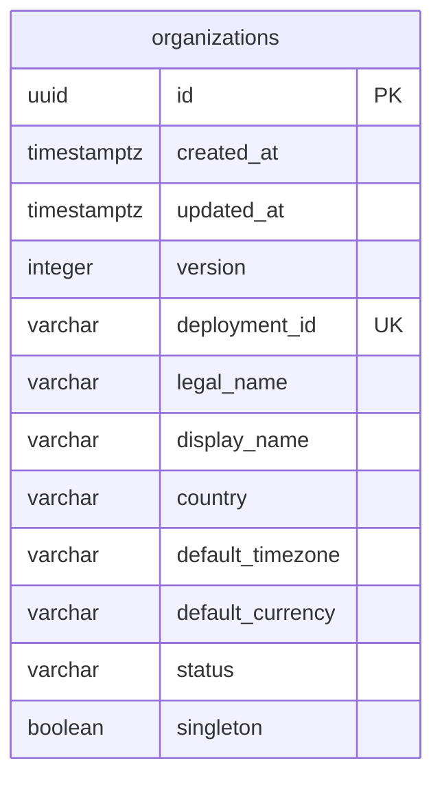

## Facilities, departments and locations (logical)

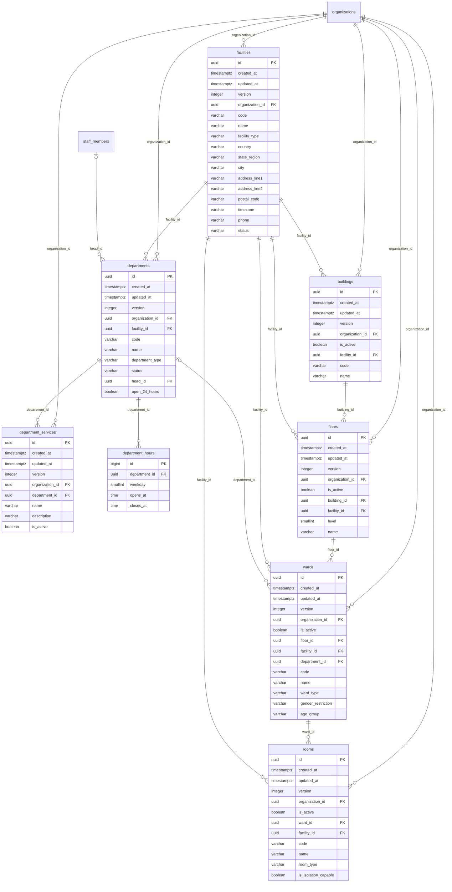

Tables from other domains are shown without columns: `organizations`, `staff_members`.

## Beds (logical)

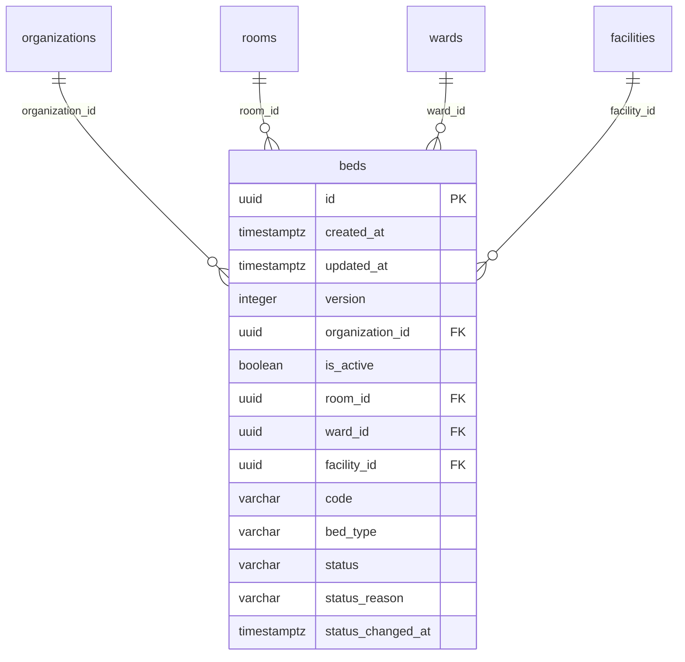

Tables from other domains are shown without columns: `facilities`, `organizations`, `rooms`, `wards`.

## Numbering (MRN, visit, invoice, claim numbers) (logical)

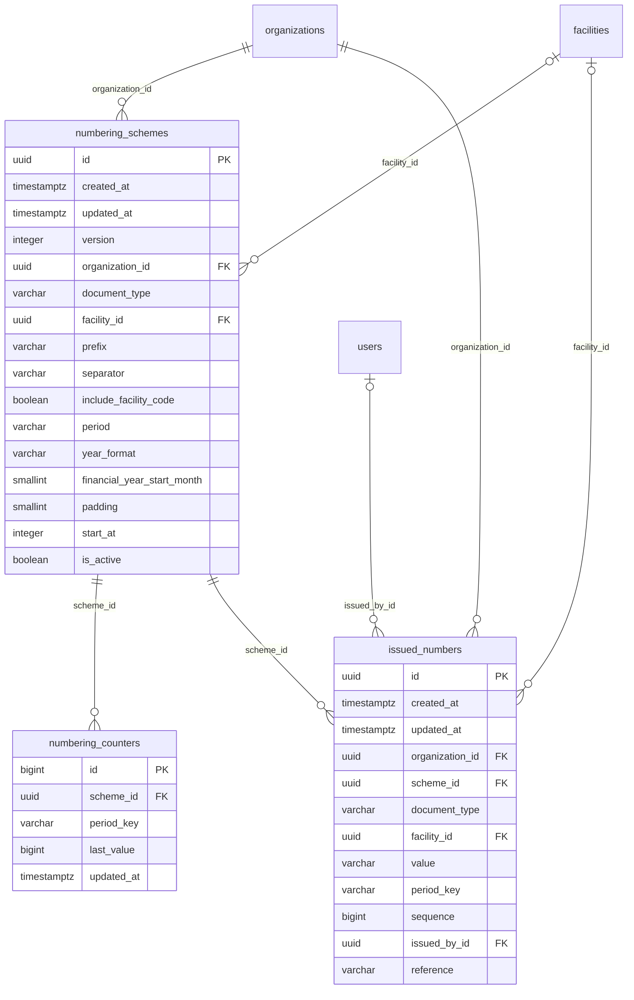

Tables from other domains are shown without columns: `facilities`, `organizations`, `users`.

## Feature settings (logical)

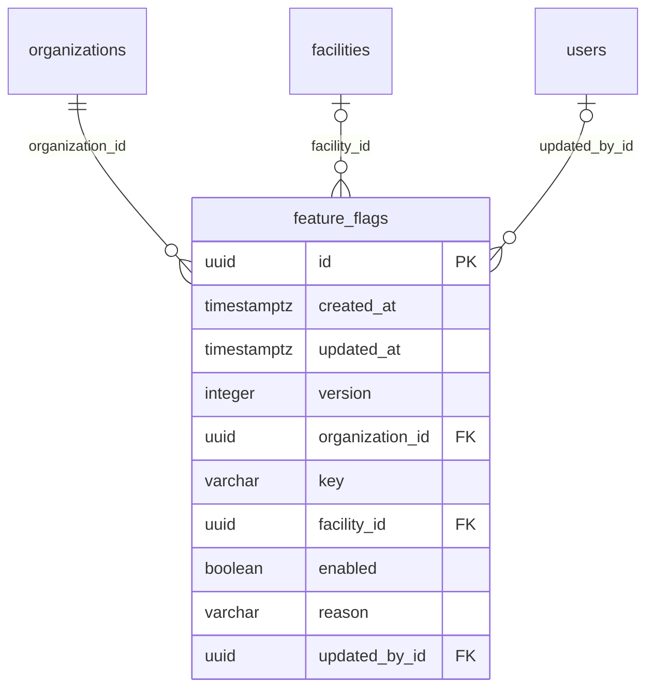

Tables from other domains are shown without columns: `facilities`, `organizations`, `users`.

## Identity: accounts, sign-in, two-factor (logical)

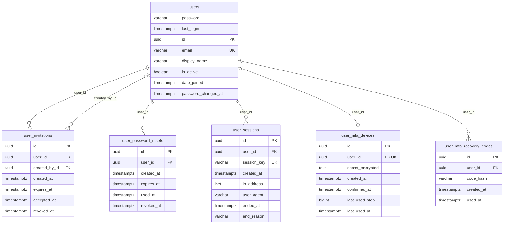

## Access control: roles, access, reviews, cover (logical)

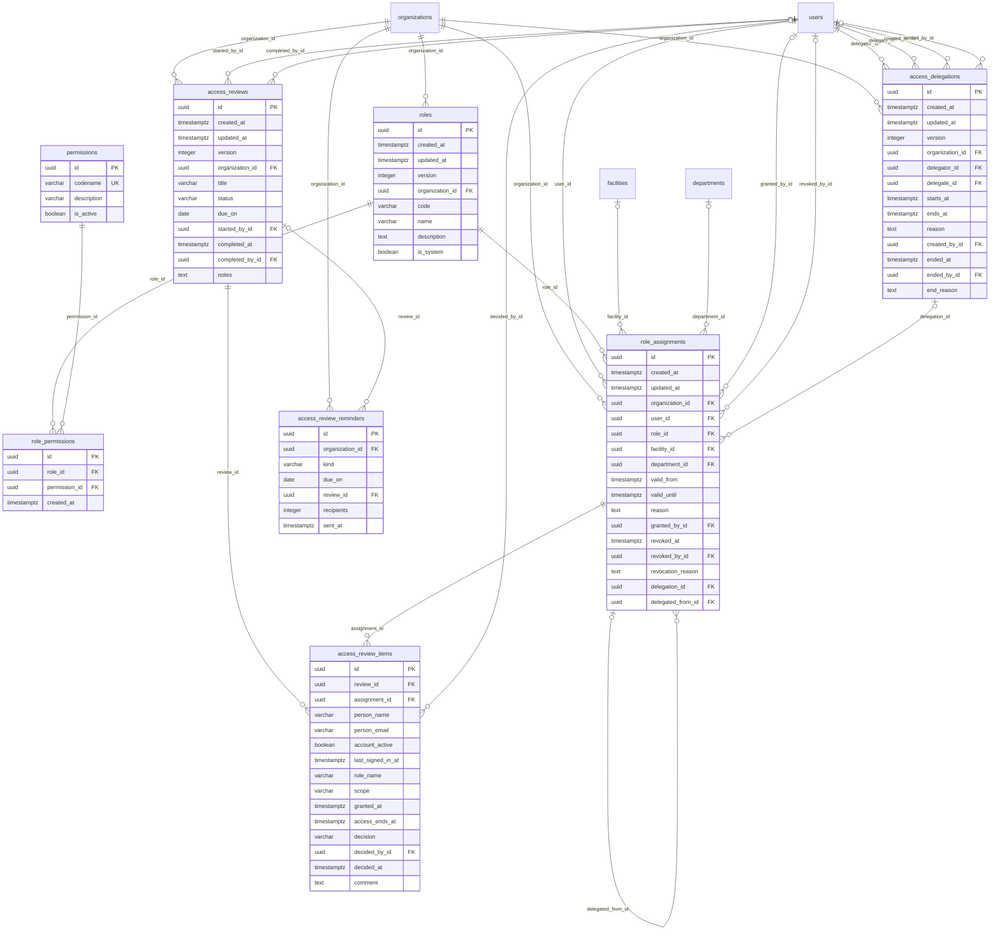

Tables from other domains are shown without columns: `departments`, `facilities`, `organizations`, `users`.

## Staff and credentials (logical)

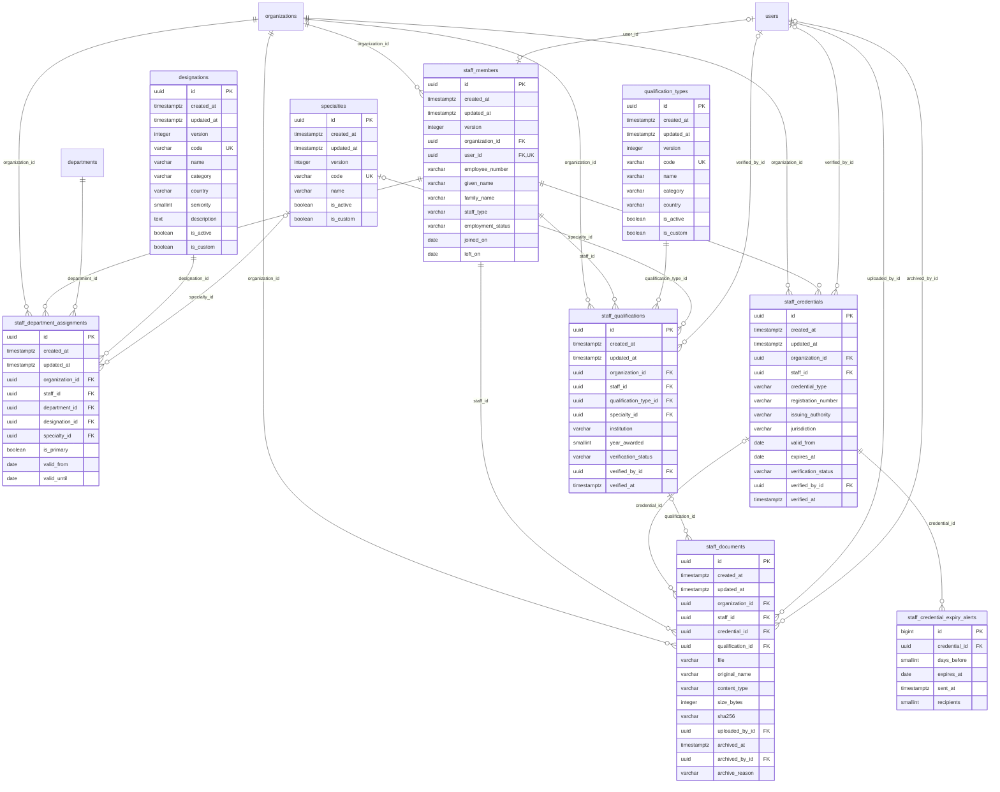

Tables from other domains are shown without columns: `departments`, `organizations`, `users`.

## Audit log and tamper evidence (logical)

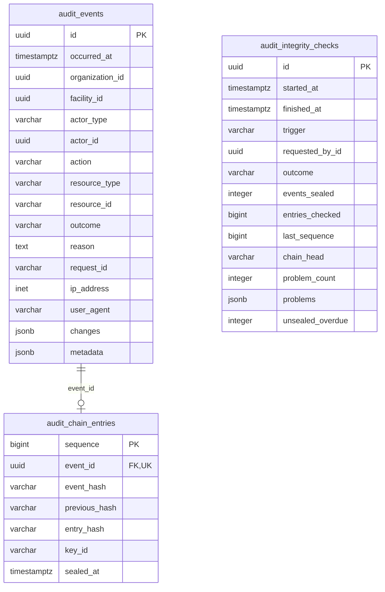

## Notifications: emails and SMS (logical)

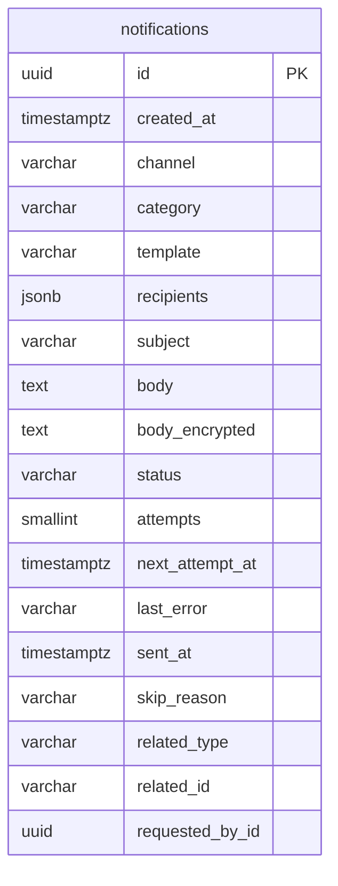

## Platform: transactional outbox (logical)

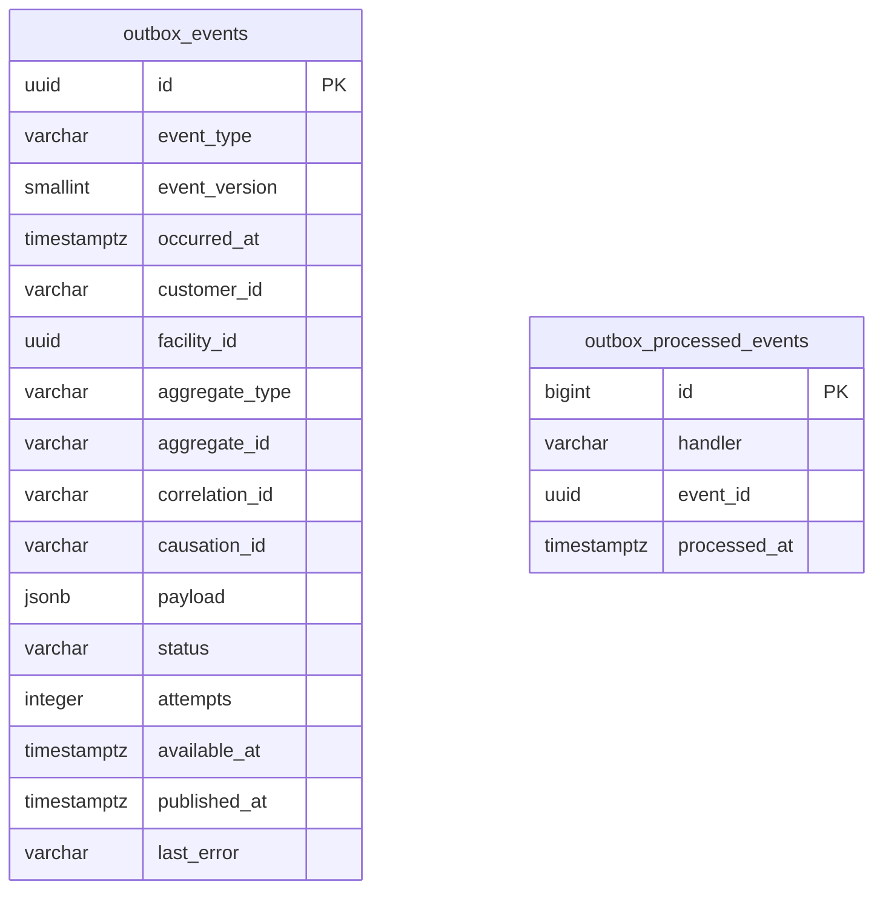

## Platform: idempotency (logical)

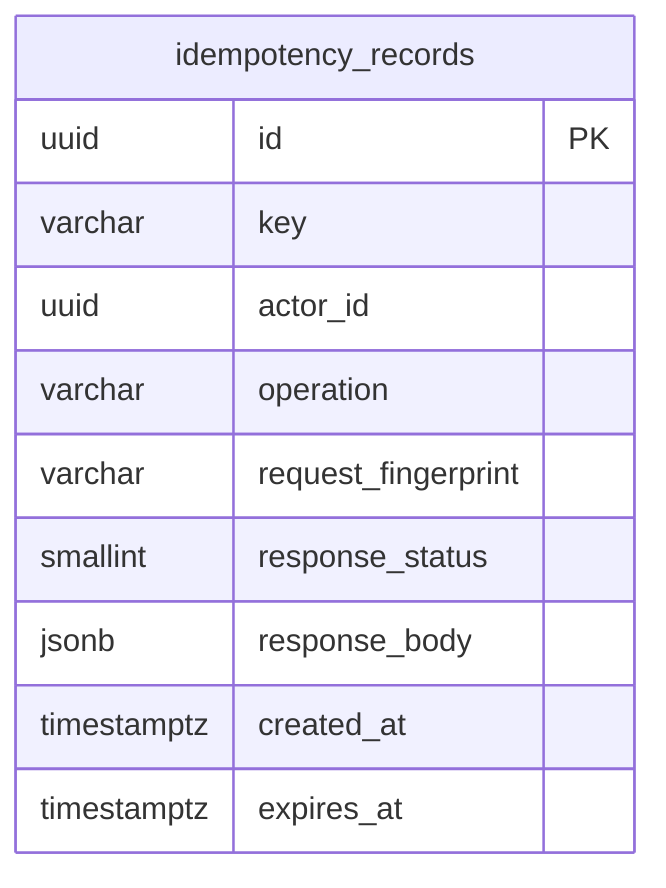
